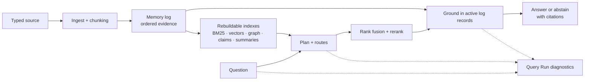

# Trisynapse Memory: Algorithms

This document is a self-contained explanation of the Trisynapse Memory architecture: what is stored, what is derived, how a question is ranked, and why an answer remains tied to evidence. It combines the system model, algorithmic background, production formulas, default constants, and implementation references.

No prior knowledge of the codebase is required. [architecture.md](architecture.md) offers a shorter product-oriented tour; [api.md](api.md) describes the public interfaces.

**Core rule:** Indexes may *point*; the memory log must *support* the answer. Claims, group summaries, and extension index records are routing hints. Final hits, citations, and answers come only from `raw_source` or `fact` records in the memory log.

---

## The architecture in one idea

Trisynapse separates **memory authority** from **search acceleration**:

1. The **memory log** is the ordered source of truth. It contains accepted source chunks and evidence-linked facts.
2. **Indexes** are disposable projections of that log: lexical postings, vectors, graph edges, claims, group summaries, and extension records.
3. **Retrieval** lets several indexes nominate candidates, fuses their rankings, and then resolves every winning helper back to active memory-log evidence.
4. A **Query Run** records the decisions and scores, but is not itself memory evidence.



The separation solves a common memory-system failure mode: a generated summary or nearest vector may be useful for finding evidence, but it should not silently become evidence. Trisynapse therefore permits broad, approximate routing while keeping the final answer boundary narrow and auditable.

### Components at a glance

| Component | Responsibility | Durable? | May be cited directly? |
|---|---|---:|---:|
| Source handler | Decode a typed source into text chunks, locators, modality, and fields | No | No |
| Ingest processor | Propose evidence-linked facts or notes after a group commits | Job is durable | Its accepted fact output may be cited |
| Memory log | Order records, preserve provenance, enforce namespaces and lifecycle | Yes | Raw sources and facts only |
| Retrieval document | Normalize text plus structured fields for search | Rebuildable | No; points to its log record |
| BM25 index | Exact lexical matching through postings | Rebuildable | No |
| Embedding index | Semantic nearest-neighbor search | Rebuildable | No |
| Graph index | Connect sequential, entity-related, and similar records | Rebuildable | No |
| Claim compiler | Aggregate compatible facts and expose conflicts | Rebuildable | No |
| Group summary | Route broad questions to a record group | Rebuildable | No |
| Query planner | Label intent/modalities and choose the active profile/routes | No | No |
| Retrieval route/branch | Produce one ranked candidate list | No | No |
| Fusion and reranker | Combine lists and produce a global pre-grounding order | No | No |
| Grounder | Resolve helpers to active evidence and enforce context budgets | No | Produces the citable set |
| Answerer | Synthesize grounded records or abstain | Durable when the Query Run is persisted | Cites grounded records |
| Query Run | Store steps, bounded candidates, timings, decisions, and provenance | Optional persistence | No |

### Formal model

Let the memory log at an explicit snapshot cutoff—or the effective committed view used to build a query index—$\tau$ be

$$
M_{\tau} = (m_1,m_2,\ldots,m_{\tau}),
$$

and let $A_{\tau} \subseteq M_{\tau}$ be the records still active after applying retractions and namespace/scope filters. Each index channel $j$ is conceptually a versioned projection

$$
I_j = P_j(A_{\tau};\theta_j),
$$

where $\theta_j$ contains tokenizer, model, prompt, or producer versions. Because $I_j$ is derived, it may be rebuilt when $\theta_j$ changes. A retrieval branch $b$ produces an ordered list $\pi_b(q,I_j)$ for query $q$. Fusion combines the lists, but grounding enforces

$$
G(q,\{\pi_b\},A_{\tau}) \subseteq
\{m\in A_{\tau}: \mathrm{kind}(m)\in\{\texttt{raw\_source},\texttt{fact}\}\}.
$$

That subset is the only evidence passed to answer generation and citation construction.

### Scores are ranking signals, not probabilities

BM25 values, cosine similarities, graph-walk strengths, RRF scores, reranker scores, and final hit scores live on different scales. Unless explicitly stated, a score of $0.8$ does **not** mean “80% likely to be correct.” These values order candidates and drive heuristic gates; they are not statistically calibrated probabilities.

## How to read this document

Each section is written in two layers:

1. **Algorithm** — what happens, why, and the formulas (no file paths).
2. **Implementation reference** — where the production code lives.

Notation, default parameters, the end-to-end search pseudocode, bibliography, and a full code map are at the end.

---

## Part I — Pipeline overview

### Algorithm

```text
WRITE PATH
  Source → chunk → memory-log append → incremental indexes (BM25, vectors, graph, claims, group summaries)

READ PATH
  Question → plan → routes → fusion → rerank → ground + context budget → confidence
                 ↑                                                   │
                 └──────── refine query / deep summary if needed ────┘
                                                                     ↓
                                                            answer or abstain
```

Retrieval is deliberately **multi-route and fused**. No single classifier picks one strategy. Every enabled route contributes ranks; weighted reciprocal rank fusion (RRF) combines them. Each attempt reranks and grounds candidates before the confidence gate decides whether to stop or retry with refinement/deep summary. A completion model is called only after the final grounded evidence passes the answer threshold.

Query Runs and Studio views are **diagnostics** over these same steps. They do not change scores.

### Notation

| Symbol | Meaning |
|---|---|
| $q$ | Query string |
| $d$ | One searchable item (memory-log record, claim, or index view) |
| $N$ | Active lexical documents in the namespace |
| $\mathrm{df}(t)$ | Document frequency of term $t$ |
| $\mathrm{avgdl}$ | Average tokenized document length |
| $\mathbf{q}$, $\mathbf{d}$ | Query and document embedding vectors |
| $r_b(d)$ | Rank of $d$ in branch $b$ (1-based) |
| $w_b$ | Fusion weight of branch $b$ |
| $\tau$ | Active memory-log sequence cutoff |
| $A_{\tau}$ | Active records visible at cutoff $\tau$ |
| $L_b$ | Number of candidates returned by branch $b$ |

### Default parameters

| Parameter | Default | Role |
|---|---|---|
| `top_k` | 12 | Maximum hits returned by `search()` |
| `max_context_items` | 24 | Cap on records passed to the answerer |
| `max_context_tokens` | 6000 | Token cap on answer context |
| `per_source_context_tokens` | 2000 | Per-source token cap |
| `graph_hops` | 2 | Graph-walk depth (`+1` in deep summary) |
| `graph_seed_top` | 5 | BM25 + semantic seeds for the graph route |
| `margin_threshold` | 0.018 | Confidence margin (`× 0.45` when relaxed) |
| `max_refinement_rounds` | 2 | Query-expansion rounds before deep summary |
| `similar_threshold` | 0.58 | Minimum cosine for live `similar_to` edges |
| `deep_summary_enabled` | true | Wider context and extra hop on hard queries |

---

## Part II — Write path

### 1. Ingest

#### Algorithm

Ingest turns a typed source (file, URL, chat, image, …) into **citable raw-source records** in the memory log. It is not a ranking stage.

**Safety bounds** (built-in): single file ≤ 25 MiB; one ingestion run ≤ 250 MiB; URL fetch blocks private/link-local addresses; archives unpack under the same limits. Bytes are stored by SHA-256 hash; the original blob is not rewritten.

**Chunking** depends on source kind:

| Kind | Chunk rule |
|---|---|
| PDF | One chunk per non-empty page |
| Code | AST / Tree-sitter symbols when available; else bounded line windows |
| Tables (CSV/XLSX) | Row or cell records plus header fields |
| Images | Vision-model description (no OCR fallback) |
| Conversation / notebook | Message or cell locators |
| Plain text / markdown | Section-aware or bounded windows |

Each chunk gets a **modality** (`code`, `table`, `image`, `document`, `conversation`, or `text`) and **retrieval fields** (symbol, path, page, speaker, …) that survive into the log and later modality routes.

**Commit order:** preprocessing may run in parallel (up to four workers), but memory-log appends are **strictly sequential** so `seq` stays contiguous. Mixed sources can fail independently.

**What updates immediately vs. later.** Retrieval documents, BM25 postings, and persisted graph edges (`followed_by`, `about_same_entity`) update in the same SQLite transaction as each append. Embeddings are content-addressed and filled from the active vector cache when a retrieval index is built; only missing text hashes require encoding. Model-backed and extension work runs through durable jobs after a record group commits.

When a record group finishes committing, the engine may enqueue:

| Job | When scheduled | What it does | What it writes |
|---|---|---|---|
| `extract_facts` | Group commit, if a completion provider is configured (or extraction is forced) | Reads all `raw_source` records in the group, calls the `facts` prompt, parses structured statements | New `fact` records, each with `evidence_refs` pointing at supporting raw sources |
| `summarize_group` | Every group commit | Builds or refreshes the **group summary** routing card for that `group_id` | Disposable index entry (`group_summary` view) used to route broad questions toward the group — not answer evidence |
| `ingest:{name}` | Group commit, for each registered ingest processor that listens to `group_committed` | Custom pipeline step over the group’s records (enrichment, domain-specific extraction, …) | New memory-log records proposed by the extension (must cite valid `evidence_refs`) |
| `index:{channel}:project` | Group commit, for each index channel with a `project` hook | Projects the group’s memory-log slice into that channel’s disposable index | Channel-specific index records (still not citable as final answers) |

These jobs are **deduplicated** per namespace, group, and evidence version so retries and overlapping writes do not spawn unbounded duplicates. With `auto_process=True` (default), the engine runs the queue immediately after scheduling.

**Other durable jobs** (not tied to every ingest commit):

| Job | When scheduled | What it does |
|---|---|---|
| `rebuild_embeddings` | Embedding provider, model, or endpoint changes (requires explicit confirmation) | Re-embeds all searchable text under the new model; old vectors stay active until the job succeeds |
| `execute_query` | A query run is created asynchronously (e.g. REST `POST /query-runs`) | Runs search + optional answer generation for one saved `query_id`; single attempt so a restart cannot repeat a billable completion |
| `extension:{id}:rebuild` | Extension install or rebuild request | Rebuilds persistent index channels owned by that extension across namespaces |

Derived facts must cite supporting raw-source IDs (`evidence_refs`). That lineage is what lets facts route retrieval without replacing the original evidence in citations.

#### Implementation reference

| Piece | Location |
|---|---|
| Source preparation and chunking | `engine/ingest/sources.py` |
| Raw-source append and fact extraction | `engine/ingest/pipeline.py` |
| Orchestration (`ingest`, `ingest_many`, jobs) | `engine/memory.py` |

---

### 2. Memory log

#### Algorithm

The memory log is an **append-ordered evidence log**. Ordinary writes only append, and each append gets a unique, contiguous sequence number `seq`. Physical privacy removal is the deliberate exception: it redacts selected record payloads, purges their search rows and retained source bytes, and preserves a minimal tombstone/removal audit. Validation checks SQLite integrity, sequence continuity, evidence links, and blob hashes. The log is practical durable storage, not a cryptographic or tamper-proof ledger.

| Kind | Role |
|---|---|
| `raw_source` | Original accepted chunk (page, row, message, code span, …) |
| `fact` | Derived statement with `evidence_refs` to raw sources |
| `note` | Human or extension remark (correction, instruction) |
| `retraction` | Logical forget; history kept, ranking disabled |
| `access` | Query audit trail; not answer evidence |

The default retrieval corpus indexes `raw_source` and `fact`. Notes remain in the log for application semantics and inspection but are not placed directly into answer context by the built-in retriever.

Logical **forget** appends a `retraction`. Physical **remove** replaces sensitive payloads with a removal marker, purges associated searchable/retained data, and writes an audit row. Retracted records do not rank.

The sequence number can provide a stable snapshot boundary. When an index snapshot with cutoff $\tau$ is active, retrieval reads only records with

$$
\mathrm{seq}(m) \le \tau.
$$

Without an active cutoff, the query builds its in-memory index from the committed rows visible during the initial read; later positive appends are not inserted into that already-built index. If $R$ is the set of record IDs targeted by retractions when lifecycle filtering runs, the active set is approximately

$$
A=\{m\in M:m\notin R\}\cap
\mathrm{Namespace}\cap\mathrm{Scope}.
$$

Evidence references form a directed acyclic lineage in normal operation: a fact points backward to existing raw sources, and an index record points to active log records. The core validates references when these records are written. Retraction automatically marks dependent generic extension-index records stale through the transitive evidence closure. Memory-log facts remain independent historical records unless they are themselves retracted or removed; applications performing a complete provenance purge should include those dependent log records explicitly.

#### Implementation reference

| Piece | Location |
|---|---|
| SQLite store, append, validation | `engine/memory_log/store.py` |

---

### 3. Incremental indexes

#### Algorithm

On each new raw-source or fact, disposable **index structures** update incrementally. They can be rebuilt entirely from the active memory log plus versioned non-secret configuration. The architectural trade-off is intentional: writes remain durable and inspectable, while read-time structures are free to optimize for different query types.

**Retrieval documents.** Each active raw source or fact becomes one searchable document with two strings:

- `text` — citable body (what citations show).
- `index_text` — what BM25 and embeddings search.

`index_text` is the body plus every retrieval field that is not an exact duplicate of the body, each as `name: value` on its own line. That lets queries hit symbols, paths, or speakers even when those tokens are absent from the body.

Tokenized `index_text` feeds an **inverted index**: for each term, SQLite stores the documents containing it and the term frequency in each document. It also maintains the collection statistics $N$, $\mathrm{avgdl}$, and $\mathrm{df}(t)$ per namespace. This converts lexical retrieval from an $O(N)$ scan into work proportional to the postings of the query terms. Retracting a record deactivates its document and postings.

**Persisted graph edges** are directed with $0 < w \le 1$:

| Edge | When | Weight (example) |
|---|---|---|
| `followed_by` | Sequential items in the same record group | forward $1.0$, backward $0.8$ |
| `about_same_entity` | Shared `subject` / `object` on facts | $0.92$ (up to 6 recent matches) |

`similar_to` edges are **not** stored at append time. At query time, pairs with cosine ≥ 0.58 may get a live edge (see Graph walk).

**Embedding index:** vectors are keyed by the hash of `index_text` and a cache identity derived from provider, endpoint, and model. During retrieval, cached vectors are reused and only missing hashes are encoded. LanceDB is preferred for nearest-neighbor lookup; SQLite is the portable exact-scan fallback. An embedding-configuration change builds a new fingerprinted partition before activation because vectors from different models do not share a meaningful coordinate system.

The three core index families have complementary failure modes:

| Family | Strong at | Weak at |
|---|---|---|
| Lexical postings | Exact names, identifiers, rare terms | Paraphrase and synonymy |
| Embeddings | Semantic similarity and paraphrase | Exact rare tokens; model/domain drift |
| Graph links | Connected and multi-hop evidence | Isolated records; bad or missing edges |

Fusion is valuable precisely because none of these is universally best.

#### Implementation reference

| Piece | Location |
|---|---|
| Postings, graph edges, lexical candidates | `engine/memory_log/store.py` |
| LanceDB / SQLite vector cache | `engine/indexes/embedding_index.py` |

---

## Part III — Index helpers

These structures are rebuilt from facts and record groups. They influence routing; they do not appear as final citations.

### 4. Lexical tokenization

#### Algorithm

Tokenization defines the vocabulary seen by every lexical algorithm. A mismatch here would make BM25, overlap scoring, refinement, and agreement disagree about what a “term” is, so the engine deliberately shares one tokenizer. Version: `unicode-code-v2`. It is identifier-aware but is not a full linguistic stemmer such as Porter.

1. Split into Unicode runs of letters, numbers, marks, and identifier punctuation (`_`, `$`, `'`, `-`).
2. CJK runs emit **unigrams and adjacent bigrams**.
3. Other runs split on `_` / `$` and camelCase, then casefold.
4. Long ASCII tokens: strip trailing `ing` (len &gt; 6) or `ed` (len &gt; 5) as a light stem variant.

The CJK bigrams preserve short local context without requiring a language-specific segmenter. Camel-case and identifier splitting let `launchAtlas`, `launch_atlas`, and a query for “launch atlas” share terms. The light suffix variants improve recall while retaining the original token.

**Answer-context token counting** is a separate problem. It estimates model input cost and limits, not lexical relevance:

1. Provider `count_tokens` callback if present (exact).
2. Else Tiktoken for known OpenAI models when installed.
3. Else approximate: $\max(1,\; |T(\text{text})|,\; \mathrm{round}(|\mathrm{utf8}| / \beta))$ with family-specific $\beta$ (OpenAI 4.0, Anthropic 3.6, default 3.8).

#### Implementation reference

| Piece | Location |
|---|---|
| Tokenizer and token counters | `engine/retrieval/tokenization.py` |

---

### 5. Claims

#### Algorithm

Facts are grouped by normalized $(\mathrm{subject}, \mathrm{relation})$. This is a compact form of entity–relation aggregation: all candidate objects for “Project Atlas — owned by → ?” occupy one bucket. Multiple distinct normalized objects produce status `CONTESTED`; the compiler never silently selects a winner.

For bucket $G$, record-group set $E$, mean confidence $\bar{c}$, and age $\Delta t$ days of the newest member (half-life $H = 90$):

$$
\mathrm{recency} = \exp\left(-\frac{\ln 2 \cdot \Delta t}{\max(H, 1)}\right)
$$

$$
\mathrm{support} = \min\left(1,\; \frac{\ln(1 + \max(|E|, 1))}{\ln 5}\right)
$$

$$
\mathrm{confidence} = 0.45\,\bar{c} + 0.35\,\mathrm{support} + 0.20\,\mathrm{recency}
$$

The support term grows logarithmically, so independent record groups help but cannot increase confidence without bound. The recency term has the half-life property $\mathrm{recency}(H)=0.5$. Contested claims multiply confidence by $0.72$. Claim IDs hash the bucket key and ordered member record IDs for reproducible rebuilds.

This confidence is an aggregation heuristic, not a Bayesian posterior. In particular, two record groups are not assumed statistically independent merely because their IDs differ.

#### Implementation reference

| Piece | Location |
|---|---|
| Claim compilation | `engine/indexes/claims.py` (`compile_claims`) |

---

### 6. Group summaries

#### Algorithm

One **routing card** is built per record group. It is analogous to a coarse document representation in hierarchical retrieval: first locate the relevant group, then inspect its fine-grained evidence.

- **With completion model:** one call using the versioned `group_summary` prompt; failures are not silently replaced.
- **Without model:** deterministic text from the first four facts (else raw sources), truncated to 900 characters, plus top terms as concept and two alt-phrasings.

Indexed routing text:

$$
\mathrm{index\_text} = \mathrm{summary} \oplus \mathrm{concept} \oplus \mathrm{alt\_phrasings}
$$

Stale summaries use confidence $0.55$ instead of $0.95$. Group summaries **never** appear in grounded hits or citations. When a summary routes successfully, its best-matching supporting records—not the summary text—seed grounding.

#### Implementation reference

| Piece | Location |
|---|---|
| Build and cache views | `engine/indexes/claims.py` (`build_group_summary_views`) |

---

## Part IV — Read path

### 7. Query planning

#### Algorithm

The planner is **not** a winner-take-all classifier. It labels the question so later stages can choose answer policy, modality emphasis, and escalation behavior, but it outputs **every enabled route name**. This is a fusion-first architecture: classification changes weights and downstream behavior rather than betting the entire query on one retrieval algorithm.

**Query kind** (first regex match wins): `multi_hop` → `inference` → `temporal` → `list` → `fact` (default).

| Kind | Typical cues |
|---|---|
| `multi_hop` | because, lead to, relationship between, how did X affect |
| `inference` | would, likely, probably, might |
| `temporal` | when, what year, before, after, how long ago |
| `list` | list, enumerate, which, how many |
| `fact` | default |

**Profile:** `auto` picks the sole detected modality, else `mixed` if several, else `balanced`. Explicit `retrieval_profile` overrides.

**Route weights:** $w = \mathrm{DEFAULT} \cup \mathrm{PROFILE}[\mathrm{profile}] \cup \mathrm{overrides}$

| Route | Default $w$ |
|---|---|
| `bm25`, `semantic`, `code`, `table`, `conversation` | $1.0$ |
| `document` | $0.95$ |
| `image` | $0.90$ |
| `temporal`, `graph` | $0.85$ |

Profile overlays (examples): `precise` boosts BM25; `broad` boosts semantic + graph; `code` / `table` / `image` / `document` / `conversation` each emphasize their modality route.

Extension branches add weights via `setdefault` — they do not override an existing core weight.

#### Implementation reference

| Piece | Location |
|---|---|
| Heuristic planner, route registry | `engine/retrieval/contracts.py` |

---

### 8. Vector similarity

#### Algorithm

An embedding model maps text to a point in $\mathbb{R}^p$. The working assumption is distributional: texts used in similar contexts should occupy nearby directions even when they do not share exact words. Trisynapse measures angular similarity with **cosine**:

$$
\cos(\mathbf{u}, \mathbf{v}) = \frac{\mathbf{u}}{\|\mathbf{u}\|_2} \cdot \frac{\mathbf{v}}{\|\mathbf{v}\|_2}
$$

For unit-normalized vectors this reduces to a dot product. Cosine is invariant to vector magnitude and lies in $[-1,1]$ mathematically, although many text encoders produce mostly non-negative useful similarities. Invalid or zero vectors score $0$.

**Nearest neighbors:** LanceDB returns cosine distance, converted by $s=1-\mathrm{distance}$. SQLite fallback scores every compatible cached vector and takes the top $L$. Production retrieval requests

$$
L=\max(200,\;8\cdot\mathrm{max\_context\_items}).
$$

The width deliberately exceeds the final context size so later fusion and grounding can discard duplicates or unsupported helpers without starving the result set.

Studio’s 2-D embedding map uses PCA for visualization only — not ranking.

#### Implementation reference

| Piece | Location |
|---|---|
| Cosine and normalization | `engine/utils.py` |
| ANN / cache | `engine/indexes/embedding_index.py` |

---

### 9. BM25

#### Algorithm

Okapi BM25 is a probabilistic-relevance ranking function derived from the Binary Independence Model. It rewards terms that are frequent in one document but rare in the collection, saturates repeated occurrences, and normalizes for document length. Trisynapse uses Lucene-style IDF with $k_1 = 1.5$ and $b = 0.75$:

$$
\mathrm{IDF}(t) = \ln\left(1 + \frac{N - \mathrm{df}(t) + 0.5}{\mathrm{df}(t) + 0.5}\right)
$$

$$
\mathrm{BM25}(t, d) = \mathrm{IDF}(t) \cdot \frac{\mathrm{tf}(t,d)\,(k_1+1)}{\mathrm{tf}(t,d) + k_1\bigl(1 - b + b \cdot |d|/\mathrm{avgdl}\bigr)}
$$

$$
\mathrm{BM25}(q, d) = \sum_{t \in \mathrm{unique}(T(q))} \mathrm{BM25}(t, d)
$$

Interpretation:

- IDF grows when $\mathrm{df}(t)$ is small, so a rare project name matters more than a common word.
- The TF fraction approaches $k_1+1$ as $\mathrm{tf}\to\infty$, preventing repeated terms from dominating linearly.
- $b=0$ disables length normalization; $b=1$ applies it fully. The production value $0.75$ is the standard compromise.

Query terms are unique, so repeating a word in the query does not add a second query-TF boost. SQLite sums posting contributions and returns at most the top 500 documents per query.

When BM25 mixes with cosine in a modality route, raw BM25 is bounded to $(0,1)$:

$$
\mathrm{bounded}(x) = \frac{x}{1 + \max(x, 0)}
$$

#### Implementation reference

| Piece | Location |
|---|---|
| BM25 primitives | `engine/utils.py` |
| Posting aggregation | `engine/memory_log/store.py` (`lexical_candidates`) |

---

### 10. Retrieval routes

#### Algorithm

The retriever embeds $q$, obtains lexical and vector candidates, then runs **enabled routes in dependency order**. Graph follows BM25 and semantic because it needs their seeds; independent routes can be evaluated without depending on one another. An empty route contributes nothing to fusion.

| Route | Behavior |
|---|---|
| **BM25** | Rank SQLite postings (or full in-memory scan). Claims and group summaries are excluded from postings unless fallback scans all items. |
| **Semantic** | ANN cosine scores; claims/summaries filled via in-memory BM25 on `index_text` so helpers still participate. |
| **Temporal** | If no date cues and kind ≠ `temporal`, returns empty. Else blends cue match in time fields, lexical overlap, and presence of a time field. “When” questions without time fields are down-weighted. |
| **Graph** | Seeds = top 5 from BM25 + semantic each; scores from graph walk (§11). |
| **Modality** (`code`, `table`, …) | Only matching modality; blends cosine, bounded BM25, and weighted field overlap. |
| **Extension branches** | After core routes; timeout and candidate caps; invalid evidence IDs rejected. |

**Modality score** (generic form):

$$
s_{\mathrm{mod}}(d) = 0.56\,\cos + 0.30\,\mathrm{bounded}(\mathrm{BM25}) + 0.14\,\mathrm{fields}(d) + 0.12 \cdot \mathbf{1}[\text{preferred modality}]
$$

Field weights vary by route (e.g. code: symbol 1.0, path 0.8; table: headers 1.0, sheet 0.8).

#### Implementation reference

| Piece | Location |
|---|---|
| Route definitions and hybrid search | `engine/retrieval/contracts.py`, `engine/retrieval/engine.py` |

---

### 11. Graph walk

#### Algorithm

The graph route uses a bounded **max-product** walk on a directed weighted graph. If an edge weight is viewed as connection strength, multiplication discounts longer paths naturally. Taking the maximum selects the strongest discovered path rather than summing many weak or cyclic paths.

- Seeds start at score $1$.
- For hop budget $h$: $s(v) \leftarrow \max_{u \to v} (s(u) \cdot w(u,v))$.
- Each iteration keeps the top **80** frontier nodes.
- Best score per node wins; worse revisits are skipped.

Equivalently, for path $p=(v_0,\ldots,v_\ell)$,

$$
s(p)=\prod_{i=0}^{\ell-1}w(v_i,v_{i+1}),\qquad
s(v)=\max_{p:\,v_0\in S,\,v_\ell=v}s(p).
$$

Because production edge weights are at most $1$, cycles cannot improve a score. The visited-best check and 80-node frontier cap bound the work. Live `similar_to` links connect each memory-log item to up to $\min(5,n-1)$ cosine neighbors when $\cos\ge0.58$.

The same walker runs during grounding, seeded from grounded memory-log IDs.

#### Implementation reference

| Piece | Location |
|---|---|
| `_graph_walk` | `engine/retrieval/engine.py` |

---

### 12. Fusion (weighted RRF)

#### Algorithm

Reciprocal Rank Fusion with constant $k = 60$:

$$
\mathrm{RRF}(d) = \sum_{b \in \text{branches}} \frac{w_b}{k + r_b(d)}
$$

$r_b(d)$ is 1-based rank in branch $b$; unranked items contribute nothing. Branches with $w_b \le 0$ are skipped.

RRF uses only rank positions, not raw branch scores. That makes it robust when BM25 values, cosine similarities, and graph strengths have incompatible scales. The constant $k=60$ prevents a single first place from overwhelming broad agreement: rank 1 contributes $1/61$, while rank 10 still contributes $1/70$ before weighting. Custom fusion strategies may replace the default; the core still validates extension evidence IDs first.

#### Implementation reference

| Piece | Location |
|---|---|
| Production fusion | `engine/extensions.py` (`WeightedRRFFusion`) |
| Shared RRF helper | `engine/utils.py` (`reciprocal_rank_fusion`) |

---

### 13. Soft rerank

#### Algorithm

RRF captures cross-route agreement but ignores the magnitude and semantics of individual scores. The default reranker therefore adds query-vector similarity, record reliability, and a coarse time-presence feature. Let $F_{\max} = \max_d \mathrm{RRF}(d)$. For each fused item:

$$
\mathrm{reliability}(d) = \mathrm{confidence}(d) \cdot \begin{cases} 0.55 & \text{stale} \\ 1 & \text{otherwise} \end{cases}
$$

$$
\mathrm{recency}(d) = \begin{cases} 1 & \text{has time field} \\ 0.5 & \text{otherwise} \end{cases}
$$

$$
s_{\mathrm{rerank}}(d) = 0.52\,\cos + 0.18\,\mathrm{reliability} + 0.10\,\mathrm{recency} + 0.20\,\frac{\mathrm{RRF}(d)}{F_{\max}}
$$

Add $0.04$ if $d$’s modality is in the plan’s preferred set.

This is a linear heuristic, not a learned-to-rank model. The “recency” feature currently means that a record has an `observed_at` or `temporal_anchor`; it does not decay continuously with age. **Confidence** uses these rerank scores (`top_score`, `margin`), not the later presentation-oriented hit scores.

#### Implementation reference

| Piece | Location |
|---|---|
| Default reranker | `engine/extensions.py` (`DefaultCandidateReranker`) |

---

### 14. Grounding to the memory log

#### Algorithm

Indexes optimize recall; **grounding** restores precision and provenance by selecting active memory-log evidence for answers. It is both a ranking stage and a security/correctness boundary: helper-only text cannot pass through merely because it ranked highly.

**Step 1 — Collect IDs**

1. Raw-source/fact IDs from top $\max(12, \mathrm{context\_limit})$ reranked items.
2. Up to five **routing seeds** (`group_summary`, compiled claim, extension):
   - Claims/extensions: add all supporting log IDs.
   - Group summary: rank supporting records by $0.72\cos + 0.28 \cdot |T(q)\cap T(d)|/|T(q)|$; take top **8** (not the whole group).
3. Graph-walk those IDs for `graph_hops`; add raw-source/fact neighbors.
4. **Deep summary** (`cold=True`): all memory-log items from record groups already represented.
5. `inference` / `multi_hop`: add memory-log IDs behind overlapping claims.

**Step 2 — Score candidates**

$$
\begin{aligned}
s_{\mathrm{ground}}(d) &= 0.56\,\cos + 0.14 \cdot \frac{|T(q) \cap T(d)|}{|T(q)|} + 0.12 \cdot \frac{\mathrm{RRF}(d)}{F_{\max}} \\
&\quad + 0.10 \cdot s_{\mathrm{rerank}}(d) + 0.05 \cdot \mathrm{confidence}(d) + 0.03 \cdot s_{\mathrm{walk}}(d) + 0.05 \cdot \mathbf{1}[\text{raw\_source}]
\end{aligned}
$$

The terms have distinct roles: cosine and lexical overlap measure direct query fit; normalized RRF and prior rerank preserve route agreement; confidence favors stronger records; graph strength rewards connected evidence; the raw-source bonus slightly prefers original material over a derived fact when otherwise comparable.

**Step 3 — Diverse context budget**

Let $C$ be the context item limit. Accept items only if: normalized token text is not an exact duplicate of an accepted item; per–record-group cap $\max(4, \lfloor C/2 \rfloor)$ when multiple groups are present; total tokens ≤ 6000; per-source bucket ≤ 2000. Deferred items retry after the group-balanced pass.

**Step 4 — Hit score** for rank $\rho$ (0 = best):

$$
s_{\mathrm{hit}}(d) = 0.65\, s_{\mathrm{rerank}}(d) + 0.35 \left(1 - \frac{\rho}{|G|}\right) + \begin{cases} 0.06 & \text{raw source} \\ 0.04 & \text{otherwise} \end{cases}
$$

`search()` returns top `top_k` hits; `query()` uses the same list under context caps.

#### Implementation reference

| Piece | Location |
|---|---|
| Catalog, helper pages, vector map | `engine/indexes/inspect.py` |
| Grounding and diversity | `engine/retrieval/engine.py` (`_ground_trace`, `_diverse_grounded`) |

---

### 15. Confidence, refinement, and deep summary

#### Algorithm

**Confidence** is an operational gate, not a correctness probability. On rerank scores $s_1 \ge s_2$, define margin $\Delta=s_1-s_2$ and configured threshold $\gamma=0.018$:

$$
\mathrm{confident} = (|H|>0)\land(s_1>0.12)\land
\bigl(\Delta\ge\gamma\;\lor\;\mathrm{agree}(H)\;\lor\;|H|=1\bigr).
$$

Grounded hits are also required to contain no `group_summary`; under the normal grounding invariant they are only raw sources or facts.

**Agreement:** mean Jaccard $J(A,B) = |A \cap B| / |A \cup B|$ between top hit tokens and hits 1–4 ≥ 0.07.

**Refinement:** up to 2 rounds — append four common non-stop terms from top-5 hit texts to $q$; stop when confident or no terms.

**Deep summary** when enabled and (not confident **or** `multi_hop`):

- Wider limit: `max_context_items` for list/inference/multi-hop, else $2 \times \mathrm{top\_k}$.
- Graph hops: `graph_hops + 1`.
- **Query lens:** subject/relation/object tokens from overlapping facts/claims, top 8 by overlap, appended to $q$.
- Re-check confidence with relaxed margin ($0.45\gamma$).
- `cold=True` expands grounding (§14).

Deep summary is a wider search over the same store, not a second memory system.

#### Implementation reference

| Piece | Location |
|---|---|
| Confidence, refinement, deep summary stages | `engine/retrieval/engine.py` |

---

### 16. Answering and abstention

#### Algorithm

The answerer receives **raw-source and fact hits only**, with stable record IDs, locators, dates, and a short policy selected from the query kind (shortest fact, temporal resolution, list aggregation, inference combination, or multi-hop chaining). The completion model is therefore asked to synthesize supplied evidence, not search the store or rely on hidden memory.

**Abstain** when: the top grounded hit is below `answer_abstain_threshold` (default 0.10); the model sets `abstain`; the answer is empty; a non-empty model answer selects no valid grounded citation; or the no-model extractive fallback finds nothing.

**Extractive fallback** (no model): prefer temporal hits with year/month; else max query-term overlap. `list` joins up to 12 texts; `inference` up to 3; else top text.

Citations: unique raw-source/fact IDs with locator, excerpt (≤ 500 chars), and `observed_at`.

#### Implementation reference

| Piece | Location |
|---|---|
| Query execution and abstention | `engine/memory.py` |

---

## Part V — Extensibility, lifecycle, and bounds

### 17. Extension packs as algorithm boundaries

An extension pack is a versioned registration unit, not a separate memory engine. It may contribute any subset of five capabilities:

| Capability | Input | Output | Core-enforced boundary |
|---|---|---|---|
| Source handler | Typed `SourceInput` | Prepared chunks | Core assigns log identity and validates the append |
| Ingest processor | Committed group evidence | Proposed fact/note records | Output kinds and evidence references are validated |
| Index channel | Memory-log change batch | Disposable index records | Namespace-scoped writer, invalidation, removal, rebuild |
| Retrieval branch | Query plan + read-only context | Ranked `RetrievalCandidate` values | Timeout, candidate cap, active evidence validation |
| Fusion/reranker | Valid branch rankings | Ordered candidate IDs | Grounding and citation rules still run afterward |

Registration is deterministic and frozen before the engine starts. Branch dependencies form a directed acyclic graph (DAG). If branch $b$ declares dependencies $D_b$, it may execute only when

$$
D_b\subseteq R,
$$

where $R$ is the set of completed core routes and extension branches. Dependencies are selected transitively, so an enabled expansion branch also activates its registered prerequisites.

Every extension candidate must satisfy an evidence predicate before fusion:

$$
\mathrm{valid}(c)=
\bigl(|E(c)|>0\bigr)\land
\bigwedge_{e\in E(c)}
\left[e\in A_{\tau}\land
\mathrm{kind}(e)\in\{\texttt{raw\_source},\texttt{fact}\}\right].
$$

A log candidate identifies exactly one evidence record. An index candidate may identify several. Invalid candidates are dropped with a diagnostic error and never enter answer context. The default branch limit is 200 candidates and the default deadline is 5 seconds; failure or timeout leaves healthy branches available for fusion.

Persistent index channels declare a `storage_revision` and a deterministic `rebuild(reader, writer)` path. When the revision changes, the engine marks the extension `rebuild_required`, keeps the memory log readable, and schedules a durable rebuild across namespaces. Atomic `writer.replace(...)` prevents readers from observing a half-rebuilt generic channel.

#### Implementation reference

| Piece | Location |
|---|---|
| Contracts, registries, lifecycle services | `engine/extensions.py` |
| Event scheduling and durable handlers | `engine/memory.py` |
| Generic extension-index storage | `engine/memory_log/store.py` |

---

### 18. Complexity and operational bounds

Let $n=|A_{\tau}|$ searchable records, $p$ the embedding dimension, $E$ the graph-edge count, $h$ the hop limit, and $U$ the number of unique fused candidates.

| Stage | Approximate work | Production bound or mitigation |
|---|---|---|
| Log append | $O(1)$ plus terms/edges for the new record | Serialized transaction; contiguous sequence |
| BM25 | $O(\sum_{t\in T(q)}|\mathrm{postings}(t)|)$ | Top 500 lexical results |
| Exact vector fallback | $O(np)$ | LanceDB nearest-neighbor index preferred |
| Similarity-edge construction | Worst case $O(n^2p)$ over uncached nodes | Up to five neighbors per source; edges persisted |
| Graph walk | Proportional to visited edges | $h=2$ normally; frontier capped at 80 per hop |
| RRF | $O(\sum_b L_b + U\log U)$ | Branch candidate caps and deadlines |
| Rerank | $O(Up)$ for cosine work | Operates only on fused candidates |
| Ground/context selection | Candidate sort plus bounded scan | 24 items, 6000 total tokens, 2000 per source by default |

The vector cache changes repeated-query cost: constructing the in-memory retrieval index still visits items and hashes `index_text`, but already encoded text is loaded by hash instead of sent to the embedding model again.

Failure boundaries follow the authority boundary:

- a source-preparation failure fails that source, not other inputs in the run;
- an ingest-processor or index-projection failure preserves committed log records and remains retryable as a durable job;
- a branch exception or timeout is recorded while healthy rankings continue;
- an invalid helper candidate cannot bypass grounding;
- changing embedding models keeps the old vector partition active until the replacement is complete;
- retraction and physical removal propagate through generic extension index records by evidence lineage.

These bounds make latency and cost predictable enough for production, but they do not make arbitrary in-process Python safe. Extensions are trusted application code, not sandboxed plugins.

---

## Part VI — End-to-end procedure

### 19. Worked ranking example

Suppose a query produces three route rankings over two records:

| Route | Weight | Rank 1 | Rank 2 |
|---|---:|---|---|
| BM25 | $1.00$ | launch record $a$ | owner record $b$ |
| Semantic | $1.00$ | owner record $b$ | launch record $a$ |
| Temporal | $0.85$ | launch record $a$ | — |

With $k=60$,

$$
\mathrm{RRF}(a)=\frac{1}{61}+\frac{1}{62}+\frac{0.85}{61}\approx0.04646,
$$

$$
\mathrm{RRF}(b)=\frac{1}{62}+\frac{1}{61}\approx0.03252.
$$

Record $a$ wins fusion because it has support from all three routes, even though semantic ranked it second. The reranker can still change this order using cosine, reliability, time presence, and modality. If $a$ were a group summary rather than a log record, grounding would use its `source_record_ids` to rank supporting raw sources/facts and would discard the summary text itself. Context selection would then enforce duplicate, group, source, item-count, and token limits before the answerer sees anything.

The numbers are illustrative—the production query normally runs more routes—but the example shows the central sequence:

$$
\text{heterogeneous rankings}\rightarrow\text{RRF agreement}\rightarrow
\text{soft rerank}\rightarrow\text{evidence grounding}\rightarrow\text{answer gate}.
$$

---

### 20. Search pseudocode

```text
SEARCH(q, top_k):
  τ ← optional active memory-log snapshot cutoff
  snapshot ← active namespace/scope records (and seq ≤ τ when τ exists)
  searchable ← raw sources + facts from snapshot
  claims ← compile_claims(facts from searchable)
  summaries ← group_summary_views()
  index ← retrieval documents + embed(searchable ∪ claims ∪ summaries)
  ensure similar_to edges among searchable log records
  plan ← planner.plan(q)                    # kind, modalities, all enabled routes
  if index empty: return cold, not confident

  hits, diag ← SEARCH_ONCE(q, index, limit=top_k, hops=graph_hops)
  confident ← IS_CONFIDENT(diag, hits)

  for round in 1 .. max_refinement_rounds:
    if confident: break
    q' ← q + key_terms(hits)
    hits, diag ← SEARCH_ONCE(q', ...)
    confident ← IS_CONFIDENT(diag, hits)

  if (not confident or plan.kind = multi_hop) and deep_summary_enabled:
    q_deep ← q + query_lens_terms(q, index)
    hits, diag ← SEARCH_ONCE(q_deep, limit=wider, hops=graph_hops+1, cold=true)
    confident ← IS_CONFIDENT(diag, hits, relaxed=true)

  save/emit bounded Query Run steps when persistence is enabled
  return hits[:top_k], stage, confident

SEARCH_ONCE(q, index, limit, hops, cold):
  q_vec ← embed(q)
  lexical ← BM25 postings for T(q)
  semantic ← nearest neighbors (cosine)
  run routes in dependency order
  run extension branches (validate, timeout)
  fused ← WeightedRRF(rankings, weights, k=60)
  reranked ← soft rerank(fused, q_vec)
  grounded ← GROUND(q, reranked, fused, hops, cold, token budget)
  score grounded hits; return hits, diagnostics

QUERY(q):
  hits ← SEARCH(q, max_context_items)
  if hits empty or hits[0].score < answer_abstain_threshold: abstain
  if completion model exists:
    answer, cited_ids, abstain ← model(q, grounded hits, answer policy)
    reject a non-abstaining answer with no valid cited_ids
  else:
    answer ← deterministic extractive fallback(hits)
  write answer step and citation-access audit; return answer + citations
```

### 21. What is not in the production path

- **Learned routing / RL** — design proposal only; all enabled routes run and fuse.
- **Winner-take-all routing** — `query_kind` adjusts deep summary and answer policy, not which routes run.
- **Group summaries as answers** — routing only; stripped before citations.
- **PCA / Studio maps** — visualization only.
- **Query Runs as memory** — diagnostics only.

Extensions may add source handlers, ingest processors, index channels, retrieval branches, fusion, and rerankers. The core still owns sequence order, evidence validation, retraction, context limits, and citations.

#### Architectural invariants

1. The memory log is the authority; indexes are projections.
2. Final answer context contains only active `raw_source` and `fact` records.
3. Every derived fact or index record retains evidence lineage.
4. Retrieval operates within one namespace and scope, honoring a configured sequence cutoff when present.
5. Rank scores are heuristic signals, not calibrated truth probabilities.
6. Extension failures may degrade their jobs or branches but cannot rewrite committed evidence.
7. Retraction disables retrieval of its targets; physical removal purges dependent generic index data and retained bytes.
8. Model and prompt identities are provenance. Provider secrets are never stored with records or Query Runs.
9. Query Runs explain reads but do not become evidence.
10. If grounded support is insufficient, the correct result is abstention.

---

## Part VII — Reference

### 22. Bibliography

#### Ranking and fusion

1. Robertson, S. and Zaragoza, H. (2009). *The Probabilistic Relevance Framework: BM25 and Beyond*. Foundations and Trends in Information Retrieval.
2. Robertson, S. E. et al. (1994). *Okapi at TREC-3*. NIST Special Publication.
3. Apache Lucene / Elasticsearch BM25 similarity (IDF form used here).
4. Cormack, G. V., Clarke, C. L. A., and Buettcher, S. (2009). *Reciprocal Rank Fusion outperforms Condorcet and individual rank learning methods*. SIGIR. $k = 60$.
5. Salton, G., Wong, A., and Yang, C. S. (1975). *A Vector Space Model for Automatic Indexing*. CACM.
6. Manning, C. D., Raghavan, P., and Schütze, H. (2008). *Introduction to Information Retrieval*. Cambridge University Press.

#### Embeddings and neighbors

7. Reimers, N. and Gurevych, I. (2019). *Sentence-BERT*. EMNLP.
8. LanceDB documentation — cosine distance $= 1 - \cos$ on unit vectors.
9. Jolliffe, I. T. (2002). *Principal Component Analysis* — Studio map only.

#### Graph, recency, agreement

10. Brin, S. and Page, L. (1998). *The anatomy of a large-scale hypertextual web search engine* — related family; this engine uses capped max-product walks, not PageRank.
11. Exponential half-life $\exp(-\ln 2 \cdot t / H)$ — claim recency ($H = 90$ days).
12. Jaccard (1912) — hit-list agreement threshold 0.07.

#### Tokenization and code

13. Unicode Standard Annex #29 — inspiration for identifier-aware splitting.
14. Tree-sitter — code **chunking** in ingest, not retrieval scoring.
15. Tiktoken — exact counts when available.

#### Related docs

16. [How Trisynapse Memory Works](architecture.md)
17. [API and Interfaces](api.md)
18. [Operations](operations.md)

---

### 23. Code map

| Algorithm | Location |
|---|---|
| Okapi BM25 | `engine/utils.py` (`bm25_term_score`, `bm25_document_score`) |
| Cosine / row normalize | `engine/utils.py` |
| Weighted RRF helper | `engine/utils.py` (`reciprocal_rank_fusion`) |
| Production fusion | `engine/extensions.py` (`WeightedRRFFusion`) |
| Soft rerank | `engine/extensions.py` (`DefaultCandidateReranker`) |
| Planner, routes, weights | `engine/retrieval/contracts.py` |
| Staged search, graph walk, grounding | `engine/retrieval/engine.py` |
| Index inspection (catalog, helper pages, vector map) | `engine/indexes/inspect.py` |
| Lexical tokens, token counters | `engine/retrieval/tokenization.py` |
| Claims, group summaries | `engine/indexes/claims.py` |
| Embedding index | `engine/indexes/embedding_index.py` |
| Postings, graph edges, lexical candidates | `engine/memory_log/store.py` |
| Ingest, extract, answer, abstain | `engine/memory.py` |
| Source chunking | `engine/ingest/sources.py` |
